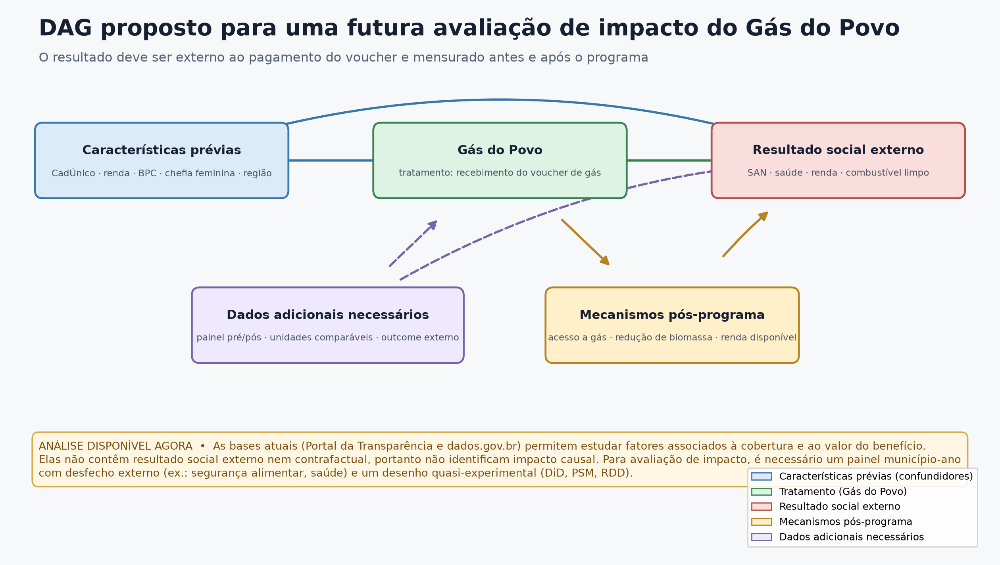

# DAG do Programa Gás do Povo

DAG metodológico e notebooks de coleta de dados para uma futura avaliação de impacto do **Gás do Povo** (Lei nº 14.973/2024), programa federal de subsídio ao gás de cozinha para famílias de baixa renda inscritas no Cadastro Único.



## Fontes de dados

| Notebook | Fonte | Cobertura | URL |
|----------|-------|-----------|-----|
| `01_download_portal_transparencia.ipynb` | Portal da Transparência / CGU | Pagamentos individuais (nov/2025–) | https://portaldatransparencia.gov.br/download-de-dados/gas-do-povo |
| `02_download_consolidado_municipio.ipynb` | dados.gov.br / MDS-SAGICAD | Consolidado por município (2021–2025) | https://dados.gov.br/dados/conjuntos-dados/programa-auxilio-gas-dos-brasileiros |
| `03_dag_gas_do_povo.ipynb` | — | DAG metodológico | — |

## Estrutura do DAG

```
Características prévias ──► Gás do Povo ──► Resultado social externo
         │                        │                     ▲
         │                        └──► Mecanismos ──────┘
         └─────────────────────────────────────────────►
Dados adicionais necessários ⟶ (tracejado)
```

### Nós

| Nó | Papel |
|----|-------|
| Características prévias | Confundidores e determinantes da elegibilidade (CadÚnico, renda, BPC, chefia feminina, região) |
| **Gás do Povo** | Tratamento: recebimento do voucher de gás |
| Resultado social externo | Desfecho causal de interesse: SAN, saúde, renda disponível |
| Mecanismos pós-programa | Mediadores: acesso a gás, redução de biomassa, renda liberada para alimentação |
| Dados adicionais | Painel pré/pós, unidades comparáveis, medida de outcome externo |

## Escopo metodológico

As bases disponíveis (pagamentos por voucher e consolidado por município) permitem estudos **associativos** — por exemplo, fatores associados à cobertura por município. Elas **não identificam impacto causal** porque:

- não contêm resultado social externo (SAN, saúde, renda);
- não contêm grupo contrafactual (famílias não beneficiárias comparáveis);
- não contêm observações anteriores ao programa para o mesmo desfecho.

Para uma avaliação de impacto, recomenda-se um painel município-ano com desfecho externo e um dos seguintes desenhos:

- **Diferenças-em-diferenças (DiD)** — antes e após a implantação por municípios;
- **Propensity Score Matching (PSM)** — controlando por variáveis do CadÚnico;
- **Regressão em descontinuidade (RDD)** — no limiar de renda per capita (½ salário mínimo).

## Arquivos

```
DAG_GAS_DO_POVO_Git/
├── 01_download_portal_transparencia.ipynb   # Download pagamentos (Portal Transparência)
├── 02_download_consolidado_municipio.ipynb  # Download consolidado por município (dados.gov.br)
├── 03_dag_gas_do_povo.ipynb                 # Construção e exibição do DAG
├── gerar_dag_gas_do_povo.py                 # Script autônomo para gerar dag_gas_do_povo.png
├── dag_gas_do_povo.png                      # DAG gerado
├── requirements.txt
└── .gitignore
```

> As pastas `raw/` e `clean/` são criadas em tempo de execução e estão no `.gitignore`.

## Reprodução

```bash
python -m venv .venv
pip install -r requirements.txt
python gerar_dag_gas_do_povo.py
# ou abra os notebooks no Jupyter/VS Code
```
